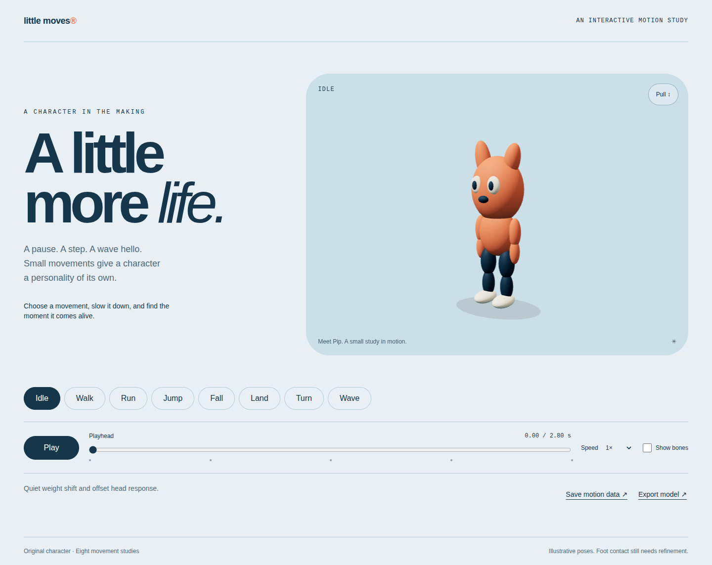

# Frontend 3D Animation

A reusable **Codex skill for React, Three.js, React Three Fiber and Tailwind CSS**. It provides implementation guidance, asset-inspection tools, motion validation and a runnable 3D character example.



## What is included

| Component | What it provides |
|---|---|
| Codex skill | A focused workflow for building and reviewing interactive 3D frontends |
| Motion lab | Original articulated character with idle, walk, run, jump, fall, land, turn and wave |
| Playback controls | Play/pause, speed, seeking, keyframe markers, bone overlay and head stretch |
| Exports | Custom motion JSON and an articulated GLB containing eight animation clips |
| Python tools | Safe project scaffolding, asset metadata inspection, preset generation and structural motion validation |
| Reference guides | Camera choreography, elastic surfaces, shader masks, character playback, Mixamo motion intake and a separate Spine workflow |
| Research | Analysis of thirteen frontend examples and a selection guide for fourteen animation, video and audio tools |
| Verification | Python and JavaScript tests, browser checks, screenshots and an explicit quality report |

The example uses React 19, Fiber 9, Three.js, Vite and Tailwind 4. The lockfile records the tested versions. Optional libraries in the research guide are not installed as runtime dependencies.

## Add the skill to Codex

### Quick install from the local ZIP

Run this in your Ubuntu/WSL terminal. No GitHub credentials are needed:

```bash
unzip -n /mnt/d/ubuntu/skill/frontend-3d-animation.zip -d "${CODEX_HOME:-$HOME/.codex}/skills"
```

Replace the ZIP path if you saved it elsewhere. The `-n` option preserves existing files; it installs missing files but does not update an older installation.

Then tell Codex:

```text
Use $frontend-3d-animation to build my 3D website.
```

### Install from GitHub

Clone the repository into your Codex skills directory. Run this only when the destination does not already exist:

```bash
mkdir -p "${CODEX_HOME:-$HOME/.codex}/skills"
git clone git@github.com:durgeshreddy-sys/frontend-3d-animation.git \
  "${CODEX_HOME:-$HOME/.codex}/skills/frontend-3d-animation"
```

If you do not use GitHub SSH authentication, replace the repository URL with:

```text
https://github.com/durgeshreddy-sys/frontend-3d-animation.git
```

Alternatively, download the repository ZIP, extract it, and place the complete folder at `~/.codex/skills/frontend-3d-animation`. If `CODEX_HOME` is configured, use its `skills` directory instead. The installed folder must directly contain `SKILL.md`, `agents`, `references`, `scripts` and `examples`.

Start a new Codex session if the skill is not listed immediately. Normal automatic selection is enabled; you can also invoke it explicitly:

```text
Use $frontend-3d-animation to build an interactive 3D landing page
using React, Three.js, React Three Fiber and Tailwind CSS.
```

Installing the skill does not install the example's npm dependencies. Install those only when running or adapting the example.

## Example prompts

**Product hero**

```text
Use $frontend-3d-animation to build a product hero around my GLB model.
Add three scroll-controlled camera shots, readable DOM text, and a
static reduced-motion view. Keep touch scrolling usable on mobile.
```

**Character animation**

```text
Use $frontend-3d-animation to inspect my character GLB and play its
existing clips. Add playback controls and review the loop seams.
Identify missing rig data before attempting retargeting.
```

**Elastic portrait**

```text
Use $frontend-3d-animation to create an Otis-style elastic portrait
using an R3F textured plane. Preserve my artwork and provide pointer
cancellation, spring release and a keyboard-operated reaction.
```

**Shader reveal**

```text
Use $frontend-3d-animation to build a cursor-painted texture reveal
on my mesh. Fade the brush trail over time and keep the heading and
CTA available when WebGL is unavailable.
```

## Run the example

From the repository root:

```bash
cd examples/motion-lab
npm ci
npm run dev
```

Open the local URL printed by Vite, normally `http://127.0.0.1:5173`. The example needs no API key or external character assets. Development was tested with Node.js 24 and Python 3.12; Python is only needed for the utility scripts and their tests.

Choose a movement, pause it, scrub the playhead or change playback speed. **Show bones** displays the hierarchy. Drag **Pull** vertically to stretch the head, or focus the button and press Enter for a nudge. Reduced motion starts playback paused and disables stretch.

**Save motion data** downloads the custom `motion-lab/v1` authoring format. **Export model** downloads a neutral articulated GLB with the eight clips. The interactive stretch controller is not baked into the export.

To create a separate project, run from the skill/repository root:

```bash
python3 scripts/scaffold.py /path/to/new-motion-project
cd /path/to/new-motion-project
npm ci
npm run dev
```

The destination must not exist. The scaffold refuses overwrites and excludes dependencies, build outputs and test artifacts.

## Utility scripts

Run these commands from the repository root:

```bash
# Inspect a local PNG, GLB/glTF, or a flat directory of assets.
python3 scripts/inspect_asset.py /path/to/character.glb

# Validate the bundled custom motion format.
python3 scripts/validate_motion.py examples/motion-lab/src/motion.json

# Generate the original presets into a new file; existing files are refused.
python3 scripts/make_presets.py /path/to/new-motion.json
```

Python utilities use only the standard library. Asset inspection reports metadata and dependency presence; it does not fetch remote resources, decode every format or reconstruct geometry. Unsupported formats are labeled `unparsed`. Motion validation checks hierarchy, references, timing, finite values, quaternion normalization and loop endpoints. It is not a general glTF or Spine validator.

## Test and build

From the repository root:

```bash
python3 -m unittest discover -s tests -v
python3 scripts/validate_motion.py examples/motion-lab/src/motion.json

cd examples/motion-lab
npm ci
npm test
npm run build
```

For browser checks, keep the Vite development server running. In a second terminal, from `examples/motion-lab`:

```bash
npx playwright install chromium
npm run test:browser
```

Set `PREVIEW_URL` if Vite is using another port, and optionally `BROWSER_PATH` to use an existing Chromium executable:

```bash
PREVIEW_URL=http://127.0.0.1:5174 npm run test:browser
```

The recorded validation passed 13 Python tests, five JavaScript tests, the production build and Chromium browser checks. See the [quality report](references/quality-report.md) for the tested environment, evidence, build-size warning and untested cases. These results apply to the bundled example, not every future character or device.

## Project structure

```text
frontend-3d-animation/
├── SKILL.md                 Codex instructions and workflow routing
├── README.md                Installation and usage
├── agents/openai.yaml       Skill display metadata and default prompt
├── assets/                  Preview screenshots
├── examples/motion-lab/     Runnable React/R3F/Tailwind example
├── references/              Technical guides, research and quality report
├── scripts/                 Python utilities
└── tests/                   Python tests and behavioral benchmark cases
```

For existing applications, adapt the relevant components and follow the project's conventions instead of replacing its structure or dependency versions.

## Guides

- [Skill instructions](SKILL.md)
- [Source-prompt analysis and requirement matrix](references/prompt-analysis.md)
- [Repository research](references/research.md)
- [Runtime architecture](references/architecture.md)
- [Elastic interaction and paint masks](references/interactions.md)
- [Camera choreography](references/camera.md)
- [Character animation and retargeting](references/characters.md)
- [Motion quality and advanced recipes](references/motion-quality.md)
- [Asset workflow](references/assets.md)
- [Optional Spine bridge](references/spine-bridge.md)
- [Fourteen-tool selection guide](references/tool-selection.md)
- [Starter details](references/starter.md)
- [Verification workflow](references/verification.md)

## Scope and limitations

- The included character uses rigid primitive meshes attached to bones. It is not a weighted skin, and its illustrative walk/run poses have no validated foot-contact solver.
- Camera and shader effects have implementation guides; full versions of all thirteen reference websites are not bundled.
- Arbitrary image-to-3D reconstruction, automatic universal retargeting and Spine export are documented routes, not implemented services.
- Advanced motion recipes require additional authored poses or suitable licensed clips.
- Mixamo guidance is animation-only. No Mixamo character meshes, textures or motion downloads are included.
- The package includes no third-party reference artwork or source code from the reviewed Spine repository. Check the relevant asset, software and model licenses before adding them to your own project.

For the complete validation boundaries, see the [quality report](references/quality-report.md).
